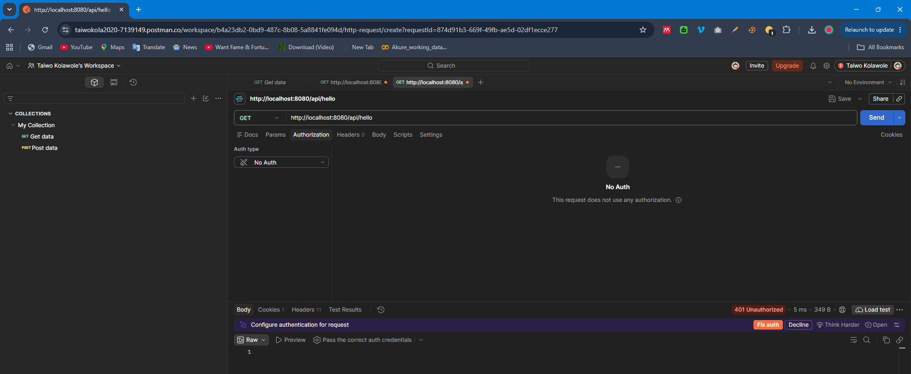
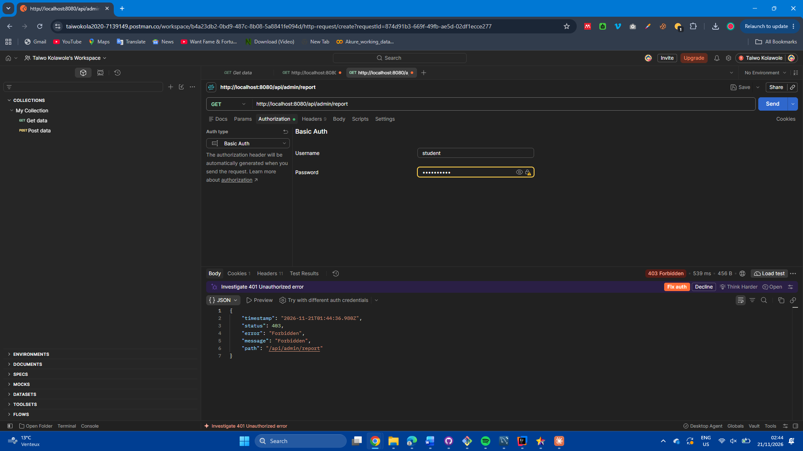

# Note on the security implemented

## Route rules (SecurityFilterChain)
| Route          | Access                 |
|----------------|------------------------|
| /api/public/** | Everyone, no login     |
| /api/admin/**  | ADMIN only             |
| /api/**        | USER or ADMIN          |
| anything else  | Any authenticated user |

All rules are evaluated in order and the first match wins, so the specific
/api/admin/** rule is declared before the general /api/** rule. Also, Authentication uses HTTP, Basic Auth.

## Results
- Anonymous (no authentication): 200 on /api/public/ping, 401 (unauthorized) in other places (/api/admin/** and /api/**).
- student (USER): 200 (ok) on /api/hello and /api/public/ping, 403 (forbidden) on /api/admin/report.
- admin (ADMIN): 200 (ok) on all three routes.

## Postman Result Verification

### 200 OK 

### Unauthenticated Access when an unauthorized person access the hello endpoint (401 Unauthorized) 

### Insufficient Permission (403 Forbidden)

## Password encoding
Passwords are hashed with Bcrypt (one-way, salted, slow). The application never
stores or compares plain-text passwords.

## Limits of in-memory users
The two accounts are hard-coded for classroom practice: they are recreated at each
restart, cannot be managed at runtime and must never be used in production.
A real setup would load users and roles from MySQL through a custom UserDetailsService.