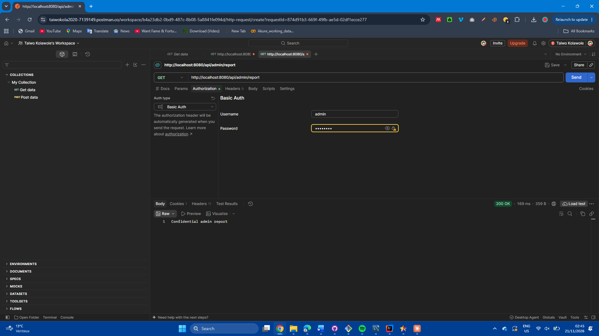
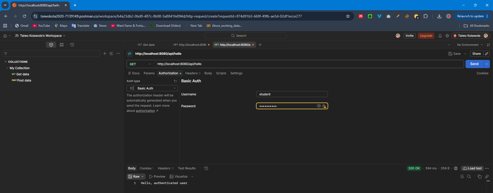
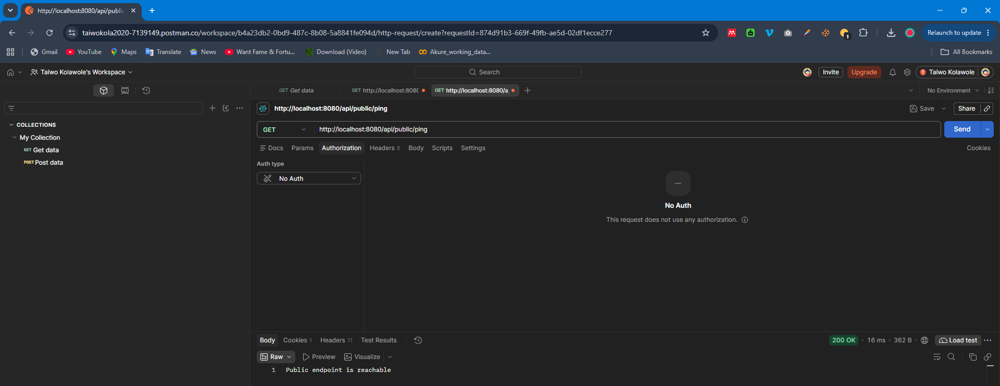

# Note on the security implemented

## Route rules (SecurityFilterChain)
| Route          | Access                 |
|----------------|------------------------|
| /api/public/** | Everyone, no login     |
| /api/admin/**  | ADMIN only             |
| /api/**        | USER or ADMIN          |
| anything else  | Any authenticated user |

All rules are evaluated in order and the first match wins, so the specific
/api/admin/** rule is declared before the general /api/** rule. Also, Authentication uses HTTP, Basic Auth.

## Results
- Anonymous (no authentication): 200 on /api/public/ping, 401 (unauthorized) in other places (/api/admin/** and /api/**).
- student (USER): 200 (ok) on /api/hello and /api/public/ping, 403 (forbidden) on /api/admin/report.
- admin (ADMIN): 200 (ok) on all three routes.

## Postman Result Verification

### 200 OK 

### Unauthenticated Access when an unauthorized person access the hello endpoint (401 Unauthorized) 

### Insufficient Permission (403 Forbidden)

## Password encoding
Passwords are hashed with Bcrypt (one-way, salted, slow). The application never
stores or compares plain-text passwords.

## Limits of in-memory users
The two accounts are hard-coded for classroom practice: they are recreated at each
restart, cannot be managed at runtime and must never be used in production.
A real setup would load users and roles from MySQL through a custom UserDetailsService.##

## Why must /api/admin/** come before /api/**? 
If /api/** came first, it would match /api/admin/report and let any USER in.

## 401 vs 403
401 (Unauthorized) means "I don't know who you are": no credentials or wrong ones.
403 (Forbidden) means "I know who you are, but you're not allowed": logged in without the required role.

## Why BCrypt? 
BCrypt is a one-way, salted, deliberately slow hash. If the user store leaks, the passwords can't be read back, the salt defeats precomputed tables, and the slowness makes guessing expensive.

## Why in-memory users only for this exercise? 
They're written in the code, lost and recreated at every restart, can't be managed without redeploying, and aren't shared between several app instances. 

## Loading users from MySQL. 
A Utilisateur entity (username, BCrypt password hash, roles) is needed, a repository with findByUsername, and a custom UserDetailsService that loads the user from the database. 
Users would be created through an API that hashes the password before saving it.